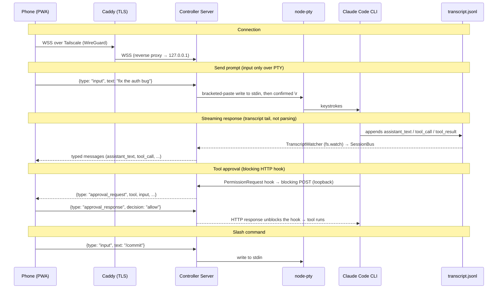
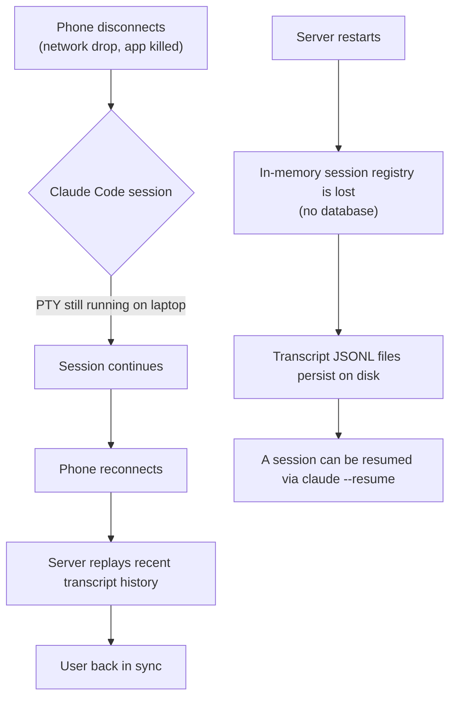
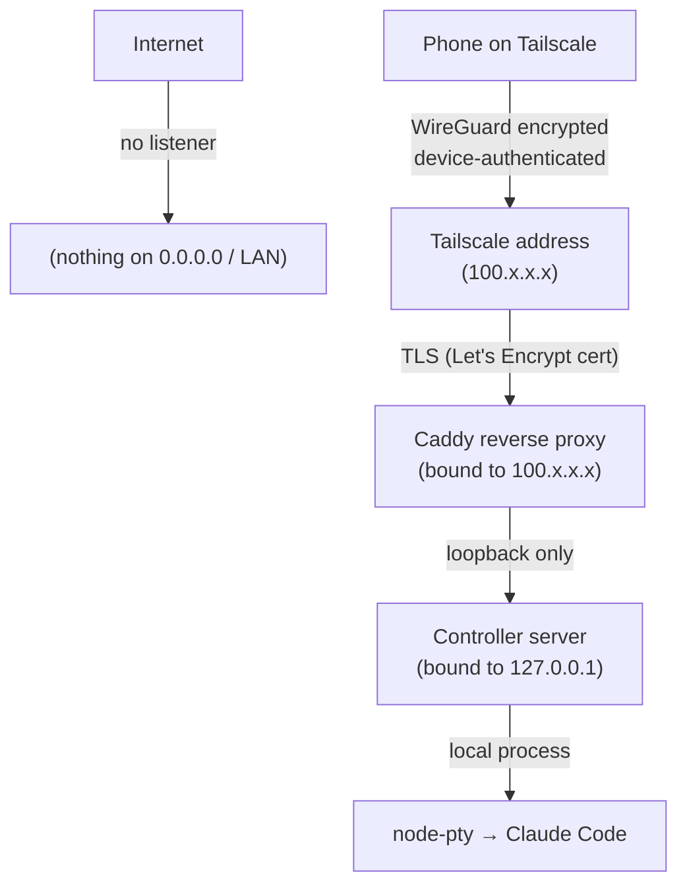

# Architecture (deep dive)

This is the excruciating-detail companion to the [README](../README.md). It covers
how the relay actually works, the wire protocol, the trickier subsystems, the
security model in full, and the decisions behind the design.

---

## Core principle: terminal relay, not an API client

Instead of calling Claude's API ourselves (which bills per token), we control the
**actual Claude Code CLI process**. From Anthropic's perspective we're
indistinguishable from you sitting at your keyboard. Consequences:

- Uses your existing **Max-plan credits** — no API key, no pay-per-token.
- **All CLI features work automatically** (slash commands, permissions, MCP, etc.).
- **Future CLI updates** are picked up for free.

The server spawns Claude Code in a PTY and consumes **two structured data
sources** — never by scraping the terminal:

1. **HTTP hooks** (control-plane: approvals, questions, compaction).
2. **The transcript JSONL** (content: assistant text, tool calls/results, prompts).

Both normalize into a per-session **`SessionBus`**, which the WS service forwards
as typed messages. **PTY stdin is used for input only**; PTY stdout is dumped to
`dump/captures/<session>.raw` for debugging and is **never parsed**.

> Hard invariant: **no regex parsing of PTY output.** Content comes from hooks +
> JSONL. The `.raw` dump exists only for debugging.

---

## The two data sources

### 1. HTTP hooks

The CLI is launched with a `--settings` JSON (written to a temp file, not inline)
that registers synchronous HTTP hooks which POST to a loopback-only endpoint.
Only **`PermissionRequest` blocks the action** until the phone answers (and fails
closed); every other hook is a signal whose handler answers `{}` at once:

- **`PermissionRequest`** — tool approvals **and** AskUserQuestion. Blocking.
- **`PreCompact` / `PostCompact`** — compaction lifecycle.
- **`PreToolUse`** (scoped to `ExitPlanMode`) — the only signal that arrives
  *before* the plan picker opens, so the plan card renders in time.
  ExitPlanMode's own `PermissionRequest` is notification-only (answering it
  resolves nothing) but it is the **picker-open** signal: see *Plan picker
  timing* below.
- **`PreToolUse`** (scoped to `SendMessage`) — the agent-to-agent message feed.
  A second `PreToolUse` entry, so `buildHooksConfig` appends per event.
- **`PostModelSwitch`** (CLI ≥ 2.1.251) — an out-of-band `/model`, carrying the
  requested *alias* rather than just the resolved id. `PreModelSwitch` is
  deliberately not registered: it exists to block or confirm a switch.
- **`SubagentStart` / `SubagentStop`** — which agents are running (the agents view).

#### Plan picker timing and the two-option variant

Measured in a bare PTY on 2.1.322 (a hook listener plus timestamps on the
render): `PreToolUse(ExitPlanMode)` fires ~2.4s before the picker exists, and the
ExitPlanMode `PermissionRequest` fires 10–50ms before it renders. The PlanCard is
drawn from the first, so a fast tap used to write its digit before the picker
existed. That digit is not merely lost: written at PreToolUse time, a `2` went into
the **main prompt box** and was still there (`> 2`) once the picker was dismissed,
ready to be prepended to the user's next prompt (an early Esc would interrupt the
turn instead). Through the controller this showed up as "Plan response could not
be confirmed by the CLI" with the picker left open and nothing able to answer it.

So `hooks.service` turns that `PermissionRequest` into a backend-internal
`plan_picker_open` bus event, and `Session.answerPlan` writes **nothing** until it
has arrived for the tracked call (plus a 300ms settle), within 20s; otherwise it
fails having written nothing. Then one write and no resend, confirmed by the
`tool_result` within 8s: a resend racing that result through the transcript would
itself land in the prompt box. No PTY output is read. `pnpm verify:plan-relay`
answers 500ms after the card, the case that used to fail.

When the model calls ExitPlanMode **without a plan**, the PreToolUse input is `{}`
(with one it carries `plan` and `planFilePath`) and the CLI shows a different
picker: `Exit plan mode? 1. Yes, and switch to default (ask each time) for this
session / 2. No`. There `1` exits plan mode and Esc rejects, as on the full
picker, but `2` means **No**, the opposite of our approve-manual. Input `{}` was
also seen twice with a plan file on disk (not reproduced; consistent with the CLI
reading the file before a parallel Write landed), when the full picker may be
showing instead. The phone cannot tell which, so for a planless input
(`planTextOf` is null) the card is drawn as "Exit plan mode?" with Yes (`1`) / No
(Esc), the backend maps any approve to `1` and never sends `2`, and no optimistic
mode is noted (`1` exits to default on the variant but auto/acceptEdits on the
full picker).

A blocked hook **holds the CLI** until the phone responds — this is how one-tap
approvals work. The pending HTTP response is unblocked by
`hooks.service.resolveApproval()` when the phone sends `approval_response`.

An approval can also carry `updatedInput`, letting the phone approve a *corrected*
call (`ApprovalCard`'s Edit… mode) rather than only allow or deny.

**Every decision uses the schema form** `{hookSpecificOutput: {hookEventName:
"PermissionRequest", decision: {behavior, updatedInput? | message}}}` (`buildApprovalResponse`). A
response the CLI does not honour falls back to its own terminal picker — invisible
to the phone, so the session hangs with no error. The PreToolUse-style flat
`{permissionDecision}` form used to work for a plain allow/deny (2.1.251) but is
**ignored on 2.1.322 for both**: checked live through the controller, a flat allow
and a flat deny each left the CLI on `Do you want to create PROBE.md? 1. Yes …
3. No` with no tool_result. (An `updatedInput` on the flat form had always been
ignored the same way.) With the schema form, a plain allow writes the file, a deny
returns its `message` to Claude as the error tool_result (a deny without a reason
sends a default message), and an edit runs the edited call. `verify:approval-edit`
only exercises the edit path, so re-test a plain allow and deny by hand when
touching this.

Since 2.1.300 an `updatedInput` is validated like Claude's own input. Observed on
2.1.322: an unknown key (`bogus_key`) is dropped and the call runs with the rest;
input the tool rejects denies the call. The transcript then records the *model's*
original `tool_use` (real `toolu_` id) and an error `tool_result`, e.g.

```text
PermissionRequest hook for Write returned updatedInput that failed schema validation: Write failed due to the following issue:
The required parameter `content` is missing
The tool input from the model was valid; the hook's rewrite of it was not.
```

(a wrong type reads ``The parameter `content` type is expected as `string` but
provided as `number` ``). The card id is synthesized (`pr:<tool>:<hash>:<seq>`;
PermissionRequest has no `tool_use_id`), so `approval-outcome.ts` pairs each
approval with its tool call by tool name + input (sorted keys) and, when that
call's result carries this prefix, `ApprovalCard` shows "Edit rejected by Claude
Code" with the reason instead of "Approved · edited". The `<seq>` suffix keeps
ids unique: Claude often retries a rejected call with identical input, and a
content-only id collided with the first card, which the frontend dedupes by id,
so the retry's approval never appeared.

**The PermissionRequest hook fails closed** (`onFailure: "block"`, 2.1.295+, and
`timeout: 86400`). Hooks reference: a failure is "an HTTP hook's connection fails,
or the response status isn't 2xx", a timeout, or invalid output ("a 2xx body that
is neither empty nor a JSON object", or one failing schema validation); "With
`"block"` set, a failure does what exit code 2 does on that event, except on
`PermissionRequest`, where it denies the request." Without it a failure is a
non-blocking error and the call goes to the normal permission flow — for us, the
invisible terminal picker. The http default timeout is 600s ("Seconds before
canceling … Defaults: 600 for command, http, and mcp_tool"). Live on 2.1.322
(throwaway runs pointing the hook at a closed port, or never answering):

| Case | default | `onFailure: "block"` |
|---|---|---|
| backend unreachable | terminal picker, hang | error tool_result `[http hook]: failed; blocking because onFailure is "block"` / `the request failed (ECONNREFUSED)` |
| no answer, `timeout: 20` | terminal picker, hang | after 20s: `[http hook]: timed out; blocking because onFailure is "block"` |
| answered after 330s, `timeout: 900` | — | honoured (edit applied) |

So a slow phone is unaffected up to the timeout (no shorter cap in the CLI's HTTP
client), which is set to a day rather than 600s; after it, or if the backend is
gone, the call is denied visibly instead of hanging, and the card shows "Denied
by Claude Code · the approval hook failed" (same pairing as above). The
`{}` the backend returns for ExitPlanMode's notification-only PermissionRequest is
a valid empty object, so the plan picker still opens (`verify:plan-relay` passes).
Other hooks keep the default: they are observational and answer `{}` at once.

**An abandoned approval expires.** Claude Code closes the held `PermissionRequest`
request when it stops waiting (Esc, a respawn or exit, an answer typed in the
terminal, the hook timeout). `handlePermissionRequest` listens for the response's
`close` before it finished, drops the pending entry and pushes an
`approval_expired` bus event (logged, so a replay locks the card too), which the
card renders as "Approval expired". A tap that arrives after that gets an `error`
with code `approval_expired` and the `toolUseId`, shown on the card as "Not
delivered". `session_stopped` also expires every open card in the stream. Live on
2.1.322: Esc on a pending Write approval produced `approval_expired` about a
second later, and the late allow got the error.

`SessionStart` is **not** HTTP-capable in Claude Code, so the session id can't be
learned from a hook, and doesn't need to be: the controller chooses it. A fresh
spawn generates a UUID and passes `--session-id <uuid>`; a resume passes
`--resume <id>`. `Session.id` is therefore set in the constructor. (It used to be
discovered from `~/.claude/sessions/<pid>.json` by cwd and start time, which
mixed up sessions started in one folder at the same moment.) A fresh session's
transcript, and possibly its project directory, appear only later;
`TranscriptWatcher` waits for both. `await session.ready` before reading a
resumed session's history, which drains asynchronously.

The hooks listener binds **`127.0.0.1` only**. Claude Code's SSRF guard blocks
hook POSTs to private IPs, and there's no reason for that endpoint to be reachable
over the network. Its port defaults to `0` (OS-assigned, collision-proof) and is
configurable via `HOOKS_PORT`; the bound port is injected into the per-session
settings, so nothing external needs to know it in advance.

### 2. Transcript JSONL

Claude Code writes a structured per-session transcript at:

```
~/.claude/projects/<encoded-cwd>/<session-id>.jsonl
```

A `TranscriptWatcher` (`transcript.service.ts`) tails this file with `fs.watch`
for **all content** — assistant text, tool calls, tool results, user prompts.
It reads raw bytes from a byte offset and decodes them with one `StringDecoder`
kept for the watcher's life: a drain can end in the middle of a multibyte UTF-8
character the CLI is still writing (emoji, CJK), and decoding each byte range on
its own turned both halves into U+FFFD. Incomplete *lines* are buffered
separately, as before.

The `<encoded-cwd>` segment replaces **every non-alphanumeric character** with
`-`, not just the path separators. Getting this wrong is the least debuggable
failure in the project: the watcher tails a directory that never appears and the
session streams nothing at all, with no error anywhere. `resolveTranscriptPath`
(`claude-paths.ts`) therefore falls back to a session-id scan for the cases the
encoding can't cover — paths over ~200 chars (disambiguated upstream since
2.1.224 under a scheme we haven't verified) and non-ASCII segments — and honours
`CLAUDE_CODE_PROJECT_DIR_NAME`.

Beyond content, the transcript is the **runtime source of truth** for three
things the controller would otherwise only guess at:

- **CLI version** — stamped on every `user`/`assistant`/`system`/`attachment`
  entry. The statusline payload carries one too, but only flows when the user has
  a statusline command configured, so it isn't dependable.
- **Model** — the resolved id, reconciled against the stored alias by family.
  See *Model aliases* below for how an unlisted family is handled.
- **Effort** — the *resolved* level, recorded on every assistant entry since
  2.1.212. Before this was read back, effort was write-only and the badge drifted
  after any out-of-band `/effort`.

Both model and effort reconciliation are **suppressed** while a respawn is in
flight or a controller-side pick is still unapplied — the stored value is the
user's intent there, not something to correct. The subtlety is that suppression
has to *defer* the observation rather than drop it: `TranscriptWatcher` dedupes
on the model id and effort level, so a value ignored while suppressed is never
reported again and the correction is lost for the life of the session.
`RuntimeReconciler` (`session/runtime-reconciler.ts`) holds the observation for
exactly that reason, and `Session.flushDeferredReconciliation` replays it on the
one path that lifts suppression without replacing the PTY — a pick that collapses
the pending overlay back to the running value (the user changing their mind).

The mirror-image trap is just as load-bearing: `_doRespawn` **invalidates** the
observations instead of replaying them, because after a respawn they describe the
process that was just killed. Reconciling a fresh `opus` intent against a stale
`claude-sonnet-5` would "correct" the alias straight back to `sonnet` and undo
the switch the user just made.

**Permission mode is the exception**, and it is worth being precise about why.
The transcript does carry a `permission-mode` entry, but only inside a periodic
session-metadata block (`last-prompt` / `mode` / `permission-mode` /
`bridge-session`) — never on the keypress that changed it, and not at all in a
session that has yet to run a turn. So it is a lagging snapshot, not a
correction. See *Permission-mode cycle* below for what depends on that.

---

## Model aliases

Claude Code adds model families over time (2.1.321 added Fable, `claude-fable-5-2`,
with a `fable` alias), and there is no model list the controller may query: the
models API needs an API key, and reading the TUI's `/model` picker would be PTY
parsing. So nothing about models is a closed list.

- **Open type.** `ClaudeModel` is `KnownClaudeModel` (the six documented aliases,
  the picker's seed list and the only capability-verified ones) or a branded
  `LearnedClaudeModel`. `isClaudeModel` checks **shape**, not membership:
  lowercase alphanumeric words joined by `-`/`.` with an optional `[1m]`, so
  `fable` and `claude-fable-5-2` pass and junk does not. Wire values (`set_pending_model`,
  respawn settings, `/model <x>` in the composer) go through it before reaching `--model`.
- **Families from structure.** `displayNameMatchesIntent` / `inferAliasFromRuntime`
  / `reconcileModelAlias` (`common/model.ts`) compare families derived by
  `parseModelId` / `modelFamily`, so any family reconciles the way opus/sonnet/haiku
  do. The real alias special cases are kept: `opusplan` (Opus in plan, Sonnet
  otherwise), haiku-in-plan, and a same-family alias incl. its `[1m]` variant is
  preserved on an id-only signal. A full id as the stored value pins its version.
- **Never pass an alias that wasn't seen working.** A family mismatch is corrected
  to an alias for the running family only if one is *known*: the seed list plus
  aliases learned by `ModelCatalogService` (`model-catalog.service.ts`, in memory)
  from a `PostModelSwitch` `requested_model`, a controller pick, or the `model` in
  `~/.claude/settings.json` at startup. Otherwise it is corrected to the **full
  observed id**, which `--model` accepts; `<family>` and `<family>[1m]` are never
  invented. So a resumed session stored as `sonnet` whose transcript shows
  `claude-fable-5-2` becomes `claude-fable-5-2` (or `fable`, once seen), and the
  next respawn keeps Fable instead of silently switching back.
- **Exposed to the client** as `model_catalog` (`{aliases, modelIds}`), sent on
  connect and on every change, sticky in the frontend `wsService`. The picker shows
  the seed aliases, every learned alias and the session's own value, hinted with
  the newest observed model of each family.
- **Unknown capabilities are gated conservatively.** Effort: a model outside the
  seed list is offered every level, and transcript effort reconciliation corrects
  the badge if the CLI resolves a lower one. Permission mode: see below.

---

## Permission-mode cycle

The mode cannot be set directly: Claude Code only exposes it as a Shift+Tab
cycle. `Session.setPermissionMode` therefore computes how many `ESC [ Z` to write
with `cycleDistance` (`common/permission-cycle.ts`) and paces them into the PTY.

```
default → acceptEdits → plan → [auto] → default
```

Whether `auto` is a stop depends on the model, and getting that wrong is a
**silent wrong-state bug**: the keystroke count is off by one, the session lands
in a mode the phone did not pick, and — because the transcript only samples the
mode in a metadata block — nothing corrects it before the next prompt *runs*
under it.

`cycleCanIncludeAuto` answers that per alias, and every answer in it is
**observed**, not derived. `pnpm verify:permission-cycle` walks the real cycle for
each `KnownClaudeModel` by pressing Shift+Tab in a live TUI and reading the mode the
CLI names in its own footer. It submits no prompt, so unlike the other probes it
costs nothing.

The result on the target build: **every alias includes auto**. `haiku` omitted it
through 2.1.251 and gained the stop by 2.1.322 — the probe caught the change, which
is exactly the kind of drift it exists for (an unchanged predicate would have
written one Shift+Tab too few on haiku and landed a `default` pick in `auto`).
`opusplan` includes it — it resolves to Opus in plan mode and Sonnet outside,
and both are auto-capable, so the dual-model alias never lands on a model that
would drop the stop. This is also a worked example of the snapshot being wrong:
`claude-code-source/` gates auto behind `/^claude-(opus|sonnet)-4-6/`, which
would exclude the Opus 5 / Sonnet 5 actually in use, and the live cycle includes
auto for both. The predicate previously excluded `opusplan` on the strength of
that reading, and the probe is what disproved it.

Any other model (a learned alias, a full id — even of a verified family) is
**unknown**: `autoCycleSupport` returns `null` and nothing is predicted.
`Session.setPermissionMode` declines (`"unverified"`, logged at warn), `ws.service`
answers `error` with code `permission_mode_unverified`, and the session re-emits its
metadata so an optimistic client reverts. The settings popover disables the mode
pills with "Mode switching isn't verified for this model yet."; at create time only
`auto` is gated, since the mode is then a spawn flag that needs no prediction. A
plan approval on such a model notes no optimistic mode. To verify a new model, add
its alias to `KnownClaudeModel` / `CLAUDE_MODELS` (the probe walks that list), run
the probe, and record the observed answer in `cycleCanIncludeAuto`.

---

## SessionBus and the WebSocket protocol

Every event from both sources normalizes into a per-session **`SessionBus`**
(`session-bus.service.ts`). The WS service (`ws.service.ts`) forwards bus events
to the phone as typed `ServerMessage`s, and applies inbound `ClientMessage`s.
Shared message types live in `packages/common` (`ServerMessage`, `ClientMessage`,
`SessionConfig`, `SessionInfo`, `PermissionMode`, `ClaudeModel`, `EffortLevel`).

### Event log retention

Each bus keeps an in-memory event log for subscribe replay (the newest 20) and
`fetch_history` paging. It is **capped** (`MAX_RETAINED_EVENTS` = 5,000 events and
`MAX_RETAINED_BYTES` ≈ 16 MiB of serialized events, never below 50 events): tool
results are stored whole, and a backend running for days otherwise grew without
limit. Past either limit the oldest events are dropped in one batch, down to 90%.

- **Indices are absolute.** `getEventLogSize()` is the count of events ever
  appended, `getFirstRetainedIndex()` the oldest one still held, and
  `getEventLogSlice(start, end)` takes absolute indices, so a client's
  `earliestIndex` means the same event after a trim.
- **Paging past the window** returns an empty page (or a short one) with
  `hasMore: false`. The transcript JSONL on disk is the full history; the
  controller does not reload trimmed events from it.
- **Lookbacks that must survive a trim don't read the log.** The bus tracks the
  kinds seen since the newest `user_prompt` (`sinceLastUserPrompt`, used by
  `hasInFlightTurn`, the post-interrupt redirect check and the transcript's
  interrupt dedupe) and every `tool_call` id (`hasToolCall`, used for agent
  parent links). The interrupt-concat echo and repeat compact-summary checks only
  read the newest few events, which the 50-event floor covers. The agent
  registry's `SendMessage` backfill reads the retained log, so on a huge resumed
  transcript the oldest messages may be missing from the agents feed.

### Data flow



### Subscriptions, reconnects and stopped sessions

- **Nothing per client survives a connection.** The backend builds a fresh
  `ClientState` for every socket, so the PWA re-subscribes after every reconnect
  (`wsService.onReconnect` in `SessionView`; the first open is the route's own
  subscribe). The replayed tail is deduped by `MessageStream` (user prompts by
  text + timestamp, replies by text, tools and approvals by id, slash commands,
  interrupts and compaction summaries by timestamp), and `history_available` never
  moves `earliestIndex` forward past pages already loaded. `AgentsSheet` asks for
  its open agent again on every `agents_snapshot`, which is sent each time the
  session subscription is (re)established, because that subscription ends every
  agent stream it owned.
- **Heartbeat, both ends.** `server.ts` pings every client every 30s and
  `terminate()`s one that missed the previous pong; `terminate` emits `close`, so
  ws.service runs the same cleanup as for a clean disconnect. Browsers answer
  protocol pings without telling the page, so the PWA also sends an app-level
  `ping` (answered `pong`) every 20s and drops a socket that delivered nothing for
  45s; on `visibilitychange` to visible, `online` and `pageshow` it reconnects at
  once if closed (skipping the backoff wait) or probes and reconnects if the probe
  is not answered within 4s.
- **Only the latest subscribe attaches.** `ClientState.subscribeGen` is bumped by
  every `subscribe` and `create_session`; one that finishes starting a session
  attaches only if it is still the latest, and an `unsubscribe` for the pending
  id cancels it. Failures reach the client as `error` code `subscribe_failed`.
- **A stopped session is never attached to.** `subscribe` uses a registry hit only
  while its PTY is alive; a stopped or crashed one (its bus is disposed, so its
  history is empty) takes the same `--resume <id>` path as a past chat, built
  from the corpse's config, and an absent one falls back to the client's
  remembered config, then disk discovery. `SessionManager.create` still reuses a
  live session instead of spawning a duplicate. Input or a slash command for a
  session with no live PTY (stopped or absent) is answered with `error` code
  `session_stopped`; `SessionView` puts the item back at the head of its queue and
  shows "Session stopped" with a Resume action (a subscribe). A session known to
  be stopped is not re-subscribed on reconnect, since that would resume it,
  unless a Resume was in progress: its answer may have died with the old socket,
  so it is asked again. A subscribe whose resumed PTY died while booting gets
  `subscribe_failed` instead of attaching to the corpse. The bus `session_stopped`
  puts an in-flight item back at the queue head, drops a bus-acked one (its turn
  was killed), re-arms Esc and ends a pending Resume.
- **Undelivered input is reported.** When an `input` reaches a live PTY but the
  respawn throws or the submit is never confirmed (`submitWithConfirmation`
  returns false and logs at error), the client gets `error` code `input_failed`;
  `SessionView` puts the item back at the queue head behind a Retry banner and
  dispatches nothing until the user consents: Retry, a new send or Send now (a
  late echo of the same text acks it instead). This error, and an input's
  `session_stopped`, go to every client subscribed to the session, not only the
  socket that sent the input: delivery takes seconds, and a phone that
  reconnected meanwhile would otherwise hold the item in flight forever. The
  client acts only while an item is in flight, so a repeat is harmless. A
  session stop clears a held Retry: the item is re-queued and Resume sends it.
- **Startup errors are shown in the chat.** A session whose transcript could not
  be read gets `error` code `session_startup_error` (with `sessionId`) on every
  subscribe while that holds; `SessionView` shows it as a banner, cleared before
  each (re-)subscribe, instead of `AppShell` toasting it each time. A Resume
  builds a new `Session`, which starts without it.
- **Resends are tied to sockets.** Every `input` write records the generation of
  the socket it went out on. After a reconnect with nothing new in the replay,
  only an in-flight item written to an older socket is resent; one buffered
  offline was flushed on the new socket before the re-subscribe and is merely
  waiting for its echo. Card responses (approval / question / plan) are kept by
  `wsService.sendResponse` and written again on each new socket until the card
  sees its outcome (a `tool_result`, an expiry, an edit outcome, or for an
  approval a result on its paired tool call; question and plan answers are
  dropped when the session stops; anything else ages out after 10 minutes, on a
  timer). Repeats are safe: `hooks.service` remembers the approvals it resolved
  and ignores a repeat (rather than answering `approval_expired`, which would
  mark a delivered answer "Not delivered"). That memory dies with a backend
  restart, so the client also swallows an `approval_expired` that answers a
  re-send rather than the first write. `Session.claimAnswer` lets a question or
  plan call be answered once, and only if this process saw the call open (a live
  `tool_call` or `pr:` approval): after a PTY death and resume the old call is
  an orphaned `tool_use`, and a re-sent answer would type into the fresh prompt,
  so it is refused with a synthetic error result. A failed delivery is final for
  that call (its synthetic error result blocks a retry), and `answerPlan` fails
  the card whenever it wrote nothing and the call has no result, so the card
  never stays "submitted" with nothing coming.
- **A resume's replayed turn is ended.** The initial drain is silent, but the bus's
  turn tracking still sees it; a transcript that ends on an unanswered prompt
  would read as a turn in flight forever (blocking the idle reaper, gating Esc,
  forcing a redirect respawn). `SessionBus.endReplayedTurn` forgets it once the
  drain is done, and the open-tool and plan-picker trackers are cleared too. A
  session idle past the timeout but held open logs its blocker once.
- **Queues are per session.** `SessionView` keeps each session's queue in a
  module-level store, so switching chats keeps queued prompts. They are
  dispatched only while their session is on screen: the backend streams only the
  subscribed session, so there is no turn-end signal for the others. On return the
  replay is filtered against the last event the queue acted on (`lastSeenAt`), so
  what happened while away drives the queue and older events do not.

---

## Input flow (and why it's confirmed)

Input flows phone → backend → PTY stdin:

1. Phone taps Send → `{type:"input"}` → backend.
2. The text is wrapped in **bracketed-paste** (`\x1b[200~…\x1b[201~`) and written
   to PTY stdin.
3. The submit `\r` is sent **separately** and **confirmed** against the transcript
   — resent if the prompt doesn't register (`Session.sendInput` /
   `submitWithConfirmation`).

The separation + confirmation exists because **a trailing `\r` coalesced into a
large paste gets stripped** by the terminal, so a naive "paste + Enter" can drop
the submit. Confirming against the transcript and resending makes it reliable.

Approvals flow back via `{type:"approval_response"}` →
`hooks.service.resolveApproval()`, which unblocks the pending `PermissionRequest`
HTTP response.

---

## AskUserQuestion relay (the keystroke-driven part)

Claude Code's `AskUserQuestion` is an interactive **ink picker**, not structured
input — so the controller renders it as a `QuestionCard` and **drives the CLI's
picker over the PTY with timed keystrokes**. This is the one place we synthesize
navigation rather than relay structured data.

- **`QuestionCard`** (frontend) renders the questions/options/preview from the
  tool-call input, collects the answer locally, and sends
  `{type:"question_response", questions, answers, cancel?}` over WS.
  `questions`/`answers` are positional; shared shapes (`QuestionSchema`,
  `AnswerEntry`) live in `common`.
- **`question.input.ts` `buildKeystrokes(...)`** is a **pure** function translating
  an answer into a `KeystrokeChunk[]` script (each chunk = bytes + optional
  `settleMs`). Navigation rules were reverse-engineered from `claude-code-source/`
  and verified against PTY captures:
  - single-select commits with `Enter` (auto-advances in a batch),
  - multi-select toggles with `Space`,
  - a preview-question note is `n` → type → **`Esc`** (not Enter) → select,
  - a batched call ends on a review screen confirmed with one `Enter`.
- **`Session.answerQuestion(chunks, confirm, toolUseId)`** paces the writes
  (`CHUNK_DELAY_MS`, honoring per-chunk `settleMs`), then confirms the answer
  landed via the bus `tool_result` for that `toolUseId`, **resending `Enter`** if a
  multi-select submit raced ink's focus flush. If it never confirms (empty script,
  or dispatch throws), `Session.failQuestion` pushes a synthetic error
  `tool_result` so the card unlocks instead of stranding the UI.
- The reducer in `MessageStream.tsx` keeps a `results` map so a `tool_result`
  **fuses onto its card** regardless of arrival order (live vs. history
  pagination), and dedupes the eager `approval_request` card against the real
  `tool_call` (the `pr:` → `toolu_` promotion).
- Pure logic is unit-tested: `buildKeystrokes`, the reducer, and the reload
  parsers (`question-result.ts`).

---

## Agents view (subagents and teammates)

Every subagent writes its own sidechain transcript, so the controller treats an
agent as a *virtual session*: the same `TranscriptWatcher` tails
`<projectDir>/<sessionId>/subagents/**/agent-<id>.jsonl` into a child `SessionBus`
addressed by a composite stream id, and the existing stream and history machinery
renders it unchanged. See *Agents view* in `CLAUDE.md` for the full contract; the
short version:

- **Tree:** rebuilt from `agent-<id>.meta.json` on disk (works for resumed
  sessions); `SubagentStart`/`SubagentStop` hooks add live status. Parent = the
  owner of the `Agent` tool call named in the meta; teammates hang off the lead.
- **Conversation:** `PreToolUse` scoped to `SendMessage` becomes `agent_message`.
  Agent teams are forced on via `CLAUDE_CODE_EXPERIMENTAL_AGENT_TEAMS` so agents
  can message each other at all.
- **Wire:** `agents_snapshot` / `agent_update` / `agent_message` on the session
  subscription; `subscribe_agent` / `unsubscribe_agent` per agent transcript.
- **Read-only.** No structured way to send input to one agent was found; the
  candidates tried and not tried are recorded in `CLAUDE.md`.

---

## Packages

| Package | Runtime | Responsibility | Key deps |
|---------|---------|----------------|----------|
| `packages/backend` | Node.js | Spawn the CLI via `node-pty` with injected `--settings` hooks; run the loopback hooks listener; tail the transcript; choose each fresh session's id (`--session-id`); normalize into `SessionBus`; serve the typed WS protocol. | `node-pty`, `ws`, `dotenv` |
| `packages/frontend` | Browser | React 19 + Vite + Tailwind 4 PWA. Renders structured message cards (`AssistantMessage`, `UserMessage`, `ToolCallCard`, `ApprovalCard`, `QuestionCard`) in `MessageStream`. Connects over WS. | React 19, Vite, Tailwind 4 |
| `packages/common` | — | Shared TS types: `ServerMessage`, `ClientMessage`, `SessionConfig`, `SessionInfo`, `PermissionMode`, `ClaudeModel`, `EffortLevel`. | — |

The backend loads `packages/backend/.env` via `dotenv` (resolved relative to the
compiled file, so cwd doesn't matter). The root launcher `scripts/start.ts` (run
by `tsx` via `pnpm start`) loads the root `.env` (Caddy vars), checks
Tailscale, validates the builds, then spawns the backend + Caddy together with
clean Ctrl+C shutdown.

---

## Session persistence



- **Phone disconnect** is cheap: the PTY keeps running on the laptop; on reconnect
  the server replays the recent transcript tail.
- **Idle stop.** A session nobody uses doesn't keep its PTY forever: opening a past
  chat spawns `claude --resume`, which used to live until an explicit Stop or a
  backend shutdown. `SessionManager.startIdleReaper` sweeps every
  `min(60s, timeout/4)` and stops a session once it has been idle for
  `ServerConfig.idleStopMs` (`IDLE_STOP_MINUTES`, default 30, `0` disables) with
  **all** of: no client subscribed to it or to one of its agents (watching counts
  as activity, so the clock restarts when the phone leaves), no turn in flight, no
  tool call without a result (a long build emits nothing for minutes), no pending
  approval or AskUserQuestion, no open plan picker, no running agent, no respawn,
  and a transcript on disk to resume from (a fresh session that never ran a turn is
  never stopped). Activity is any live bus event or input written to the PTY.
  Reopening it takes the ordinary resume path; the id and transcript are untouched.
- **Eviction.** A stopped session is dropped from `SessionManager` once its PTY
  exits (deferred a tick, so subscribers send `session_stopped` first), or 5s
  after `stop()` if no exit is ever reported. Eviction runs the idempotent
  `Session.stop()` (so a natural exit gets the same cleanup: transcript and
  statusline watchers, agent registry, timers, the orphan-reaper record), denies
  and forgets any approvals the hooks service still holds for it, broadcasts
  `session_stopped` to every client (an idle stop has no subscriber) and detaches
  any subscription still holding its listeners. Both are skipped when a resume of
  the same id is already running. After eviction the id is unknown: hooks for its
  spawn token answer `{}`, `fetch_history` gets an empty final page, and
  subscribe resumes it.
- **Respawns are serialized.** A respawn requested while one runs waits for it and
  runs once more (further requests join that one). It only waits for the old PTY's
  exit when one is running (an exited PTY emits no further exit, which used to hang
  it with `respawning` stuck true), gives up waiting after 5s, and resets
  `respawning` in a `finally`. If no PTY is running afterwards (spawn threw, or the
  new process died while starting) the session is marked stopped and `exit` is
  emitted. `PtyService` ignores the late exit and output of a process it has
  already replaced, and its delayed kill only targets the process it was asked to
  kill.
- **Backend restart** loses the in-memory session registry (there's no database).
  Transcripts persist on disk, so a session can be resumed via `claude --resume`
  (the subscribe path can disk-discover a single session). See the Roadmap's
  *session-registry persistence* item.

---

## What we build vs. what we reuse

| Component | Build / Reuse | Notes |
|-----------|---------------|-------|
| Transport encryption | Reuse (Tailscale / WireGuard) | Peer-to-peer, end-to-end encrypted |
| TLS termination | Reuse (Caddy + tailscale cert) | Real Let's Encrypt certs for `*.ts.net` |
| Device auth & ACLs | Reuse (Tailscale) | Device approval, tailnet lock, ACLs |
| Structured CLI signals | Reuse (hooks + transcript JSONL) | No scraping — the CLI emits both |
| Controller server | **Build** | PTY, hooks listener, transcript tail, relay |
| Hooks + transcript ingestion | **Build** | Normalize into a typed `SessionBus` |
| React PWA | **Build** | Approval cards, dashboard, command palette |

---

## Security

### What we're protecting

Your personal machine with full filesystem access, potentially running Claude Code
in `bypassPermissions` mode.

### Layers (defense in depth)



1. **Network** — backend binds `127.0.0.1`, Caddy binds the Tailscale IP. Nothing
   listens on `0.0.0.0` or the LAN, so there's no public/LAN attack surface.
2. **VPN** — Tailscale requires device authentication; only approved devices join.
3. **TLS** — Caddy terminates TLS with a real cert; encrypted even within the tailnet.
4. **Application** — the WS/CORS layer **fails closed** in production: a request
   with no `Origin`, or one not in `ALLOWED_ORIGINS`, is rejected
   (`isOriginAllowed` in `utils/constants.ts`).

### Tailscale hardening checklist

- **2FA** on the identity provider — highest-leverage single control. (FIDO2 keys
  are stronger but overkill for personal use.)
- **Tailnet lock** — new devices must be signed by an existing trusted device.
- **ACLs** — only allow phone → laptop on the Caddy HTTPS port.
- **Device approval** — manually approve new devices joining the tailnet.
- **Key expiry** — keep the default 180-day expiry.

### Ingestion security

- The controller **never auto-acts** — approvals and AskUserQuestion answers
  require explicit input from the phone; a blocking hook just holds the CLI until
  the user responds.
- Ingestion is **read-only**: tailing the JSONL and receiving hook POSTs presents
  information, never synthesizes actions — the one exception is the AskUserQuestion
  keystroke relay, which only fires in response to an explicit phone answer.
- The hooks listener is **loopback-only** behind Claude Code's SSRF guard.
- CLI updates changing the JSONL entry shape or hook payload schema can break
  ingestion (a maintenance burden, not a security risk).

### Risks that exist regardless (Claude Code's own surface)

These apply whether you use this tool, SSH, or sit at the laptop — **this tool does
not increase them**:

- Prompt injection via Claude's output
- Terminal escape sequences
- Keystroke interception (keyloggers)
- Resource exhaustion from spawning processes

### Phone as the weakest link

If the phone is unlocked and stolen, the attacker has tailnet access and possibly a
live session. Mitigations: a strong device passcode (not just biometric), a short
auto-lock timeout, remote wipe, and a PWA idle timeout (see Roadmap).

---

## Key decisions

- **No Agent SDK** — it requires API keys with pay-per-token billing and can't use
  Max-plan credits. (One report: $1,800 in surprise charges in 2 days.)
- **No Vercel AI SDK** — it calls LLM APIs directly. We don't call Claude's API at
  all — we control the CLI, which does that internally.
- **Anthropic's third-party restrictions don't apply** — the Jan–Apr 2026
  crackdown targeted tools piggybacking on claude.ai OAuth subscriptions. We
  control a local CLI authenticated by the user's own login.
- **Approach A — direct PTY** (a 3-entity SSH bridge was rejected). If WSS + the
  tailnet is compromised, SSH keys on the same machine are likely compromised too;
  SSH adds setup burden without meaningful security gain for a same-machine deploy.
- **Hosted Tailscale over self-hosted Headscale** — see the ADR in the project's
  decision log. (Headscale needs a public VPS + domain + DNS-01 cert flow; hosted
  Tailscale is free for personal use with zero servers. Migration to Headscale
  later is low-effort since the clients are identical.)
- **No database** — in-memory state; sessions don't survive a backend restart
  (transcripts persist on disk).
- **pnpm monorepo** — three packages; shared types in `common`.

---

## Tech stack

| Layer | Choice | Rationale |
|-------|--------|-----------|
| Runtime | Node.js | Required by `node-pty`; CLI spawned as a child process |
| Monorepo | pnpm workspaces | 3 packages — `backend`, `frontend`, `common` |
| Lint/format | Biome | Single tool, no ESLint/Prettier |
| Launcher | tsx (`scripts/start.ts`) | Cross-platform; `pnpm start` |
| PTY | node-pty | The standard (VS Code uses it) |
| WebSocket | ws | Fast, well-maintained |
| Frontend | React 19 + Vite | Fast dev, good PWA support |
| Styling | Tailwind CSS 4 | Mobile-responsive |
| Transport | Tailscale (user-provided) | WireGuard VPN, free personal tier |
| TLS | Caddy (user-provided) | Auto-certs from the local Tailscale daemon |
| State | In-memory | No database; transcripts persist via the CLI |

---

## Reference implementations

Prior art studied while designing the relay:

| Tool | What we learn from it |
|------|----------------------|
| [ttyd](https://github.com/tsl0922/ttyd) | Web terminal bound to a specific interface; auth patterns |
| [Wetty](https://github.com/butlerx/wetty) | Node.js + xterm.js + WebSocket architecture |
| [GoTTY](https://github.com/sorenisanerd/gotty) | Random-URL security, read-only defaults |

---

## Invariants (don't break these)

- **Never** use the Agent SDK or call Claude's API directly — it would incur
  pay-per-token billing instead of Max-plan credits.
- **No regex parsing of PTY output** — content comes from hooks + JSONL; the `.raw`
  dump is debug-only.
- **Hooks listener is loopback-only** (`127.0.0.1`) — Claude Code's SSRF guard
  blocks private IPs.
- **The backend binds loopback**; only Caddy faces the tailnet.
- **Shared types go in `packages/common`** — both backend and frontend import them.
- **Never let the spawned CLI inherit the parent's Claude Code env**
  (`STRIPPED_CHILD_ENV` in `pty.service.ts`). `CLAUDE_CODE_CHILD_SESSION`
  disables transcript saving and `CLAUDE_CODE_SAFE_MODE` disables hooks — both
  remove a load-bearing data source while the session still looks healthy.
- **Every CLI probe asserts a control case.** Without one, "the hook didn't fire"
  is indistinguishable from "the probe is broken" — a mistake already made once
  here, and the reason `scripts/verify` exits `2 INCONCLUSIVE` rather than
  reporting a finding it can't support.

## Testing

Two tiers, deliberately separate:

- **`pnpm test`** — Vitest over `packages/*/tests/`. Pure logic only: version
  comparison, type guards, path encoding. Fast, free, safe to run constantly.
  Tests sit outside `src` because that's each package's build `rootDir`.
- **`scripts/verify/`** — `pnpm verify:hooks`, `verify:model-switch`,
  `verify:approval-edit`, `verify:permission-cycle`. These drive a real Claude
  Code process, so they're excluded from `pnpm test` and run deliberately, on a
  version bump. All but `verify:permission-cycle` submit a prompt and therefore
  **cost plan credits**.

The harness does **not** cover the picker relays. `question.input.ts` and
`plan.input.ts` drive ink pickers by synthesised navigation and need an
interactive PTY plus a human reading the result; `scripts/verify/README.md`
documents that manual pass. `verify:permission-cycle` is the one keystroke relay
it does cover, and only because the outcome is a mode the TUI names on screen —
a picker selection is not. A green harness run means the hook contracts held and
Shift+Tab still lands where we think, not that the relays work.

## Claude Code version alignment

The controller drives a CLI it does not ship or pin. The keystroke relays, JSONL
shapes, and hook contracts were reverse-engineered against one build, and drift
fails silently rather than loudly — so the version is tracked explicitly.

```
packages/common/src/version.ts
  CLAUDE_CODE_TARGET_VERSION              fallback / last-verified build (static)
  CLAUDE_CODE_MINIMUM_VERSION             hard floor for the question relay (static)
  CLAUDE_CODE_REFERENCE_SNAPSHOT_VERSION  the frozen claude-code-source/ snapshot
  classifyCliVersion(observed, ref)       -> "match" | "older" | "newer"
packages/backend/src/services/cli-version.service.ts
  resolveCliReference(claudeBin)          runs `<claudeBin> --version` once at startup
```

- **The drift reference is the installed binary.** At startup the backend runs
  `<claudeBin> --version` once (`execFile`, no shell, 10s timeout), parses the
  leading dotted version ("2.1.322 (Claude Code)" → `2.1.322`), logs it at info,
  and hands it to every `Session` via `SessionDeps.cliReferenceVersion`.
  `Session.handleCliVersion` and `getInfo()` classify the running session's
  version against it. It is resolved once: a backend that outlives an upgrade
  keeps comparing against the build it started with until restarted.
- **Fallback.** If the probe fails (binary missing, timeout, unparseable output)
  the reference is the static `CLAUDE_CODE_TARGET_VERSION` and this is logged at
  **error** (warn is outside the default log level). That constant is now only
  this fallback and the last build the relays were manually verified against;
  bump it after re-verifying them. `scripts/verify/` reads it from the built
  common package and is deliberately **not** dynamic.
- **What the status now means.** A non-`match` `cliVersionStatus` says *this
  session is running a different build than the one installed now* (typically a
  session resumed across an upgrade, or a PATH change under a long-lived
  backend). It no longer says *a build we have not verified*: an up-to-date
  install always matches itself, whether or not the relays were ever tested on
  it. Verification is still a manual act (`pnpm verify:*` plus the picker pass).
- **The minimum floor stays static.** `CLAUDE_CODE_MINIMUM_VERSION` /
  `isBelowMinimumVersion` guard the AskUserQuestion keystroke relay, which
  silently produces wrong answers on old builds. That is correctness, not drift,
  so it is never derived from the installed binary and keeps its error-level log.
- The **transcript** is the runtime source of the *session's* version: Claude Code
  stamps `version` on every `user`/`assistant`/`system`/`attachment` entry.
  `TranscriptWatcher.noteCliVersion` → `Session.handleCliVersion` warns on
  mismatch and publishes `cliVersion` / `cliVersionStatus` on `SessionInfo`. The
  statusline payload also carries a version but only flows when a statusline
  command is configured, so it is not a dependable source. A mismatch is
  informational, never fatal. The UI does not currently display the version.
- Which binary runs is decided by the environment: the PTY spawns bare `claude`
  off PATH unless `CLAUDE_BIN` pins an absolute path. On a machine with multiple
  installs, PATH order silently picks the build; the startup probe runs the same
  `claudeBin`, so it reports the build the PTY will launch.

Model names follow the same principle: nothing in the UI hard-codes a model name
or version. `common/model.ts` `parseModelId` / `formatModelName` read the
transcript model id structurally (`claude-sonnet-5-5` → "Sonnet 5.5"; no lookup
table), and the top-bar badge shows nothing until a model has been observed.

## Known couplings to CLI input handling

Things the controller depends on that live in Claude Code's input layer rather
than in a contract it publishes. None is a bug today. They are recorded with
their **evidence status** so a future reader knows which are established and
which are inherited from a changelog and never checked.

**A leading `!` puts the CLI into shell mode — verified.** Every controller
message is written as a bracketed paste, and pasting is *not* exempt from prefix
handling: pasting `!echo hi` renders `! echo hi` in the textarea with the footer
`! for shell mode`, so on submit the text runs as a shell command instead of
reaching Claude. A `!` anywhere but the first character is inert (`run !echo hi`
stays plain text). The asymmetry that makes this worth knowing is that the phone
renders no shell-mode indicator, so unlike at the keyboard the user gets no
warning. Deliberately not escaped or warned about yet: escaping would corrupt
legitimate text and suppressing the prefix would remove a real CLI feature, so
it is a product decision rather than a fix.

**A leading `/` opens the slash-command palette — verified, and intended.**
Pasting `/model` opens the command menu and submits as a slash command. This is
the behaviour we want: a phone message of `/commit` should run the command, as
the data-flow diagram above already shows.

**A slash command after leading whitespace runs as a command since 2.1.319 —
from the changelog, unverified.** Upstream: "Fixed slash commands typed after a
leading space, tab or newline being sent to Claude as plain text instead of
running". So a phone message of ` /compact` (or a newline then `/compact`) now
runs `/compact` rather than reaching Claude as text, as it did on earlier builds.
The controller neither trims nor escapes the message, consistent with the `/` and
`!` notes above: what the user typed is what the CLI receives.

**Plan-picker digit shortcuts are position-sensitive.** At high context usage the
CLI inserts a "clear context" approve at position 1, shifting the elevated
approve to 2 and manual to 3, so `buildPlanKeystrokes`' digits would select the
wrong option. Detecting it needs the statusline context percentage, which is
deliberately not a source of app state. Already recorded as a KNOWN LIMITATION in
`plan.input.ts`; correct at normal context, best-effort at high.

**The submit `\r` can be answered by an unsolicited dialog below 2.1.247.**
Upstream that release made install suggestions and the auto-mode offer "wait
until you've sent or cleared what you're typing, so the Enter that sends your
prompt can't answer them". `submitWithConfirmation` writes exactly that Enter,
and it resends. This is *situational* — it needs a suggestion to appear — so it
is deliberately **not** folded into `CLAUDE_CODE_MINIMUM_VERSION`, which is
reserved for defects that make a relay systematically wrong. The arrow-then-Enter
race from 2.1.235 *is* systematic and did raise the floor; see `version.ts`.

**Esc-Esc at an idle prompt — unverified, probe inconclusive.** Upstream 2.1.216
describes Esc-Esc at an idle prompt opening the rewind picker. Both
`buildKeystrokes` and `buildPlanKeystrokes` emit a single bare Esc on cancel and
`Session.interrupt` writes one — there is exactly one `pty.write("\x1b")` in the
codebase — so we never emit two within one action. The residual hazard is two
user actions in quick succession arriving after the picker has already closed.
Three Escs 1.5 s apart at an idle prompt on a fresh session produced no visible
change, but that settles nothing: the session had no history to rewind to and the
double-press window may be far tighter than 1.5 s. With no control proving the
picker *can* open in that harness, the claim stands unconfirmed rather than
refuted.

**`keybindings.json` can rebind Enter**, which `submitWithConfirmation` assumes
when it writes `\r`. The file is absent on the development machine, so the
default binding applies there. If a user rebinds submit, the resend loop would
retry and give up rather than fail loudly. Unverified.

**A resume can open a usage warning since 2.1.304 — from the changelog,
unverified.** Upstream: "Added a warning on Pro and Max plans when resuming an
inactive conversation would use a noticeable share of your 5-hour usage limit:
resume anyway, or start a new conversation". Every model or effort change
respawns with `--resume` and then pastes the prompt and sends Enter, so if the
warning appears that Enter answers it, and nothing tells the phone which option
it chose. Likeliest on a large conversation whose prompt cache has expired.
Needs a PTY capture of a real resume before any handling is designed.

**Invisible characters are cleaned and reviewed since 2.1.277 — from the
changelog, unverified.** Upstream removes "invisible Unicode formatting and tag
characters" and shows the cleaned prompt for review. Since 2.1.316 plain prompts
send cleaned on the first Enter, but "commands still wait for review", so a slash
command carrying such a character waits, and `submitWithConfirmation`'s resent
Enter confirms the review for the user. That matches intent (the user sent the
command), so the controller deliberately does not strip characters itself.

**Vim mode changes what one Esc does in a question note — from the changelog,
unverified.** 2.1.301: "Esc cancels only from NORMAL" in vim mode.
`buildKeystrokes` leaves the preview-notes field with a single Esc, which in vim
INSERT mode would only switch to NORMAL. The relay assumes the default editing
mode; `verify:question-relay` runs without vim mode.

**Edited approvals are validated since 2.1.300 — verified live on 2.1.322.**
Upstream: "updatedInput from PreToolUse and PermissionRequest hooks is now
validated like Claude's own input: unknown keys are dropped, and input the tool
rejects denies the call". An unknown key is dropped silently (the call runs); a
missing required field or a wrong type denies the call with a `PermissionRequest
hook for <Tool> returned updatedInput that failed schema validation: …` tool_result,
which the approval card now shows (see *1. HTTP hooks* above). A misspelled *required*
key is therefore a rejection, a misspelled optional one is silently lost.

## Reference: Claude Code source

`claude-code-source/` (gitignored, not built) contains a snapshot of the CLI source
used to understand hook payloads, the JSONL entry shape, and `--settings` handling:

- `src/main.tsx` — `--settings` JSON parsing
- `src/utils/hooks/execHttpHook.ts` — HTTP hook POST contract
- `src/entrypoints/sdk/coreSchemas.ts` — hook event payload schemas
- `src/schemas/hooks.ts` — settings.json hook config shape (zod)

The snapshot is **frozen at v2.1.87 and cannot be refreshed** — it exists only
because a one-time source-map exposure made the unbundled TypeScript briefly
downloadable, and the shipped CLI is a compiled Bun binary whose strings are
compressed. It is a hint about intent, not ground truth for current behavior;
verify against live PTY captures instead.
